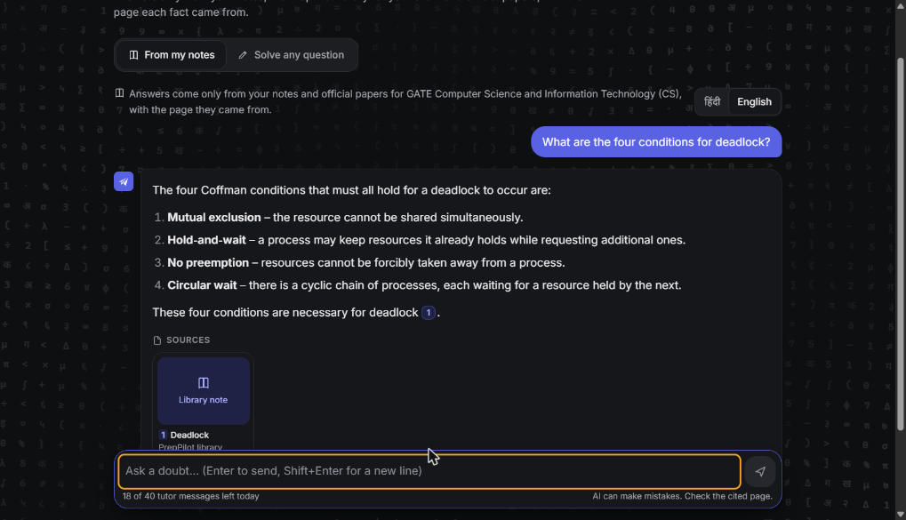
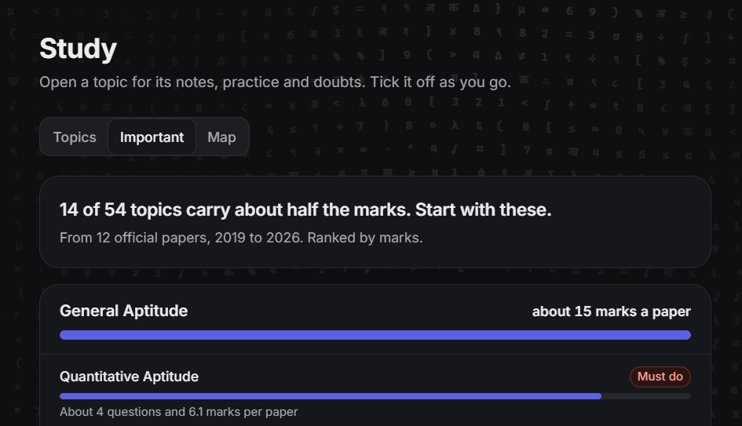
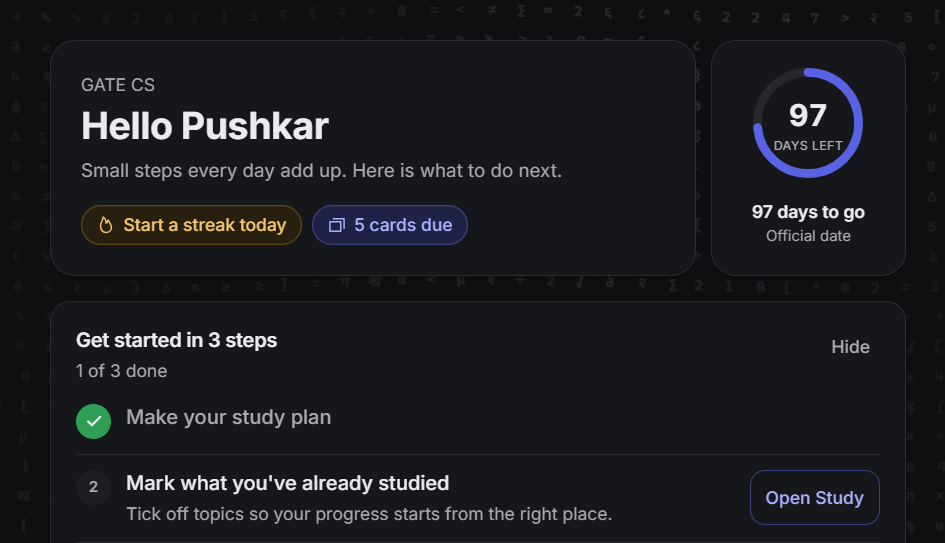
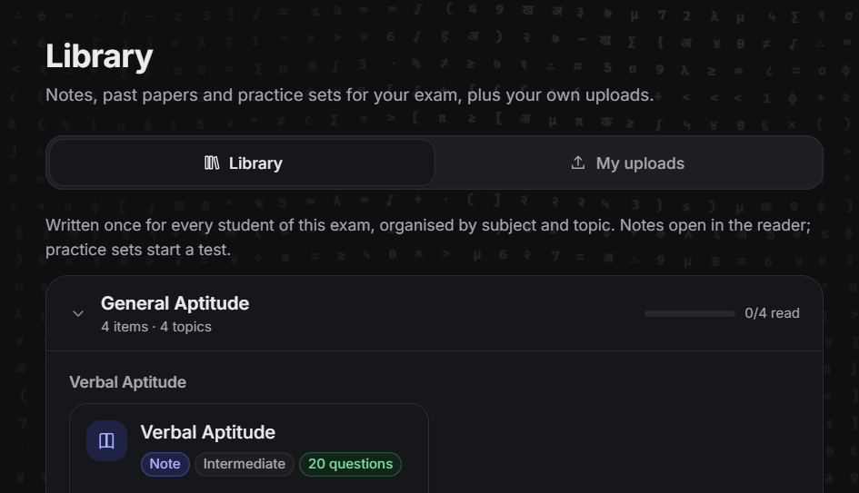
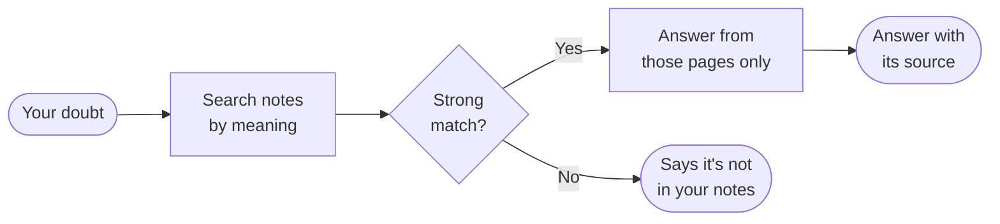

  

  
  

  Past papers, notes, mock tests and a study plan for Indian competitive exams, in one calm place. 
  <b>Ask a doubt and the answer shows the page it came from. If the notes don't cover it, it says so.</b>

<table align="center">
  <tr>
    <td align="center"><h2>30</h2>exams from official notifications</td>
    <td align="center"><h2>2,183</h2>syllabus topics</td>
    <td align="center"><h2>780</h2>GATE CS past-paper questions</td>
    <td align="center"><h2>2</h2>languages, Hindi and English</td>
  </tr>
</table>

## See it

<table>
  <tr>
    <td width="50%">
<b>Ask</b> Every answer links to its source
</td>
    <td width="50%">
<b>Important topics</b> 14 of 54 GATE CS topics carry about half the marks
</td>
  </tr>
  <tr>
    <td width="50%">
<b>Today</b> Your countdown and what to do next
</td>
    <td width="50%">
<b>Library</b> Notes by subject and topic, with progress
</td>
  </tr>
</table>

> [!TIP]
> Try the [interactive page](https://pushkarsingh0074.github.io/preppilot/): ask a sample doubt, take a three-question mock test and explore the marks chart. Click anywhere and the background ripples, just like in the app.

## What it does

| | |
|---|---|
| **Ask with sources** | Doubts answered from notes and official papers, with the page shown |
| **Mock tests** | The real exam screen: timer, palette, mark for review, negative marking |
| **Past papers** | Official papers as timed tests, with topic analysis |
| **Important topics** | Where the marks really are, so you know what to study first |
| **Notes library** | Notes by subject and topic, ready to read |
| **Study planner** | A day-by-day plan up to your exam date |
| **Revision** | Mistake log, flashcards and formula sheets |
| **Your own uploads** | Add PDFs or photos and ask questions from them |
| **Hindi and English** | Switch language at any time |

## How an answer is made

## Built with

  
  
  
  
  
  
  
  
  
  

## Good to know

- The app runs on a free server, so the first visit can take up to a minute to wake.
- This repository holds the project page only. The application code is private.
- PrepPilot is not affiliated with NTA, the IITs or any exam body. Official papers belong to their publishers.
- AI can make mistakes, so check the cited page.

© 2026 <a href="https://github.com/PushkarSingh0074">Pushkar Singh</a>. All rights reserved.

